  

###

<h1 data-importer="text" align="center">Hi 👋, I'm Sultan Madni</h1>

###

<h3 data-importer="text" align="center">A passionate flutter developer from Pakistan</h3>

###

  

###

<h2 data-importer="text" align="left">👨‍💻 About Me:</h2>

###

📚 I'm currently learning Advanced Flutter, Clean Architecture, and Scalable Mobile App Development. 🎯 Goals: Become a professional Mobile App Developer and build modern, user-friendly, and high-performance mobile applications. 🎲 Fun fact: I enjoy experimenting with UI designs and building practice apps to improve my Flutter development skills.

###

<h2 data-importer="text" align="left">🌐 Connect with Me:</h2>

###

  
  

###

<h2 data-importer="text" align="left">🛠 Languages and Tools:</h2>

###

  
  
  
  
  
  
  
  
  
  
  
  
  
  
  
  
  
  
  
  
  
  
  
  
  
  
  

###

<h2 data-importer="text" align="left">📊 GitHub Stats:</h2>

###

  
  
  

###

<h2 data-importer="text" align="left">📊 Contribution Heatmap & Activity:</h2>

